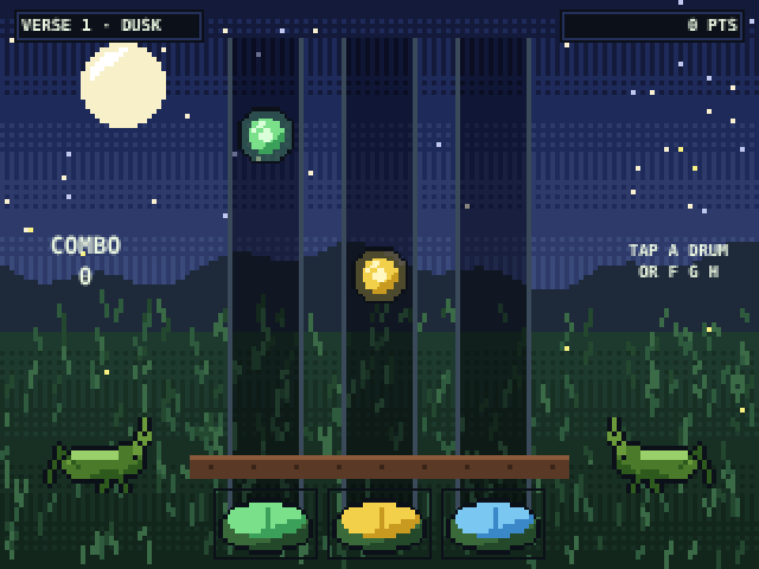
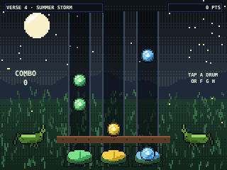
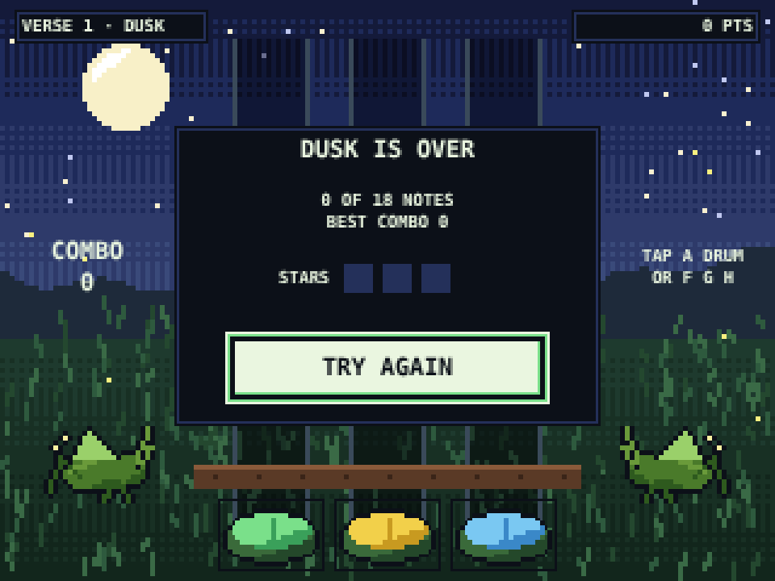

# Cricket Chorus

A rhythm game in a moonlit meadow. Tap the leaf drums (or F, G, H) as the glowing notes cross the log, over five verses from dusk through a summer storm to dawn. Made with [GameBean Studio](https://github.com/icakinser/gamebean-studio).

## Play

- **In a browser:** download `index.html` and open it. On a phone, tap the drums.
- **In GameBean Studio:** **FILE > Open…** > **Browse this computer…** and pick `cricket-chorus-cartridge.json` (or `index.html`) to open it in the editor. It is also under **Full games** in **FILE > New Game…**.

The controls are listed under **Controls in the finished game** below.

| | |
| --- | --- |
|  |  |
|  |  |

---

## Build it yourself

**Cricket Chorus** is a rhythm game in a moonlit meadow. Glowing notes slide down three lanes in time with the song. Tap the leaf drum under a lane (or press **F**, **G** or **H**) just as a note crosses the log. Hits in a row build a **combo** worth more points. Each of the five verses (**Dusk**, **Firefly Hour**, **Midnight**, **Summer Storm** and **Dawn**) is faster or busier than the last, and each is graded with up to three stars.


It shows off:

- **Entities** made at run time: three notes kept in **MY ENTITIES** and hatched by **Spawn entity** beans.
- A **For loop** that keeps the beat, with a **Calculate** formula that writes the note chart and a **Select case** that sends each note.
- **Play music** with a Music maker song per verse, timed so the notes land on the beat.
- A **formula condition** that checks a tap was in the right lane at the right moment (`abs(x + 12 - padx) < 8`).
- **Calculate** for the combo bonus and the best combo, **Key input** for F, G and H, a **Meter** of stars, its **own title and You win screens**.

**What you will learn:** how to keep time with a loop, and how notes, drums and a score talk to each other with messages.

**Time:** about 45 minutes.

---

## Before you start

### Learn the editor moves

If you have not used the GameBean Studio editor before, read **[GameBean Studio editor basics](EDITOR-BASICS.md)** first. The moves you will repeat most:

| The tutorial says                  | You do                                                                                                                    |
| ---------------------------------- | ------------------------------------------------------------------------------------------------------------------------- |
| **Place a Spikes**                 | Toolbox > **OBJECTS** tab > click **Spikes** > click the map > click **DONE** ([§8](EDITOR-BASICS.md#8-place-an-object))  |
| **Name it X, at `8, 4, 200 × 16`** | Type the name, then X, Y, W and H ([§9](EDITOR-BASICS.md#9-name-an-object-and-type-its-position-and-size))                |
| **Remove Hazard**                  | Click the **×** on the Hazard card ([§10](EDITOR-BASICS.md#10-bean-cards-turn-off-reorder-remove-and-change-settings))    |
| **Add Button (Actions)**           | **ADD ACTION** > type "Button" > click **Button** ([§11](EDITOR-BASICS.md#11-add-a-bean))                                 |
| **Sprite `name/idle.png`**         | **SPRITE** > **IMPORT PNG / SHEET** > pick the file > **SAVE SPRITE** ([§15](EDITOR-BASICS.md#15-sprites-import-or-draw)) |
| **`WHEN On click / tap · DO …`**   | **ADVANCED** > **ADD LOGIC RULE** ([§14](EDITOR-BASICS.md#14-rules-when--do-))                                            |

Every object in this game is a **Spikes** with its **Hazard** bean removed, used as a plain thing to look at, tap or carry rules. A **UI object** below means exactly that: a Spikes, Hazard removed, with a **see-through sprite** (SPRITE > clear every pixel, or set its look to none) and the Screen UI bean named.

### Get the sprite files

The pictures are in [`sprites/cricket-chorus`](sprites/cricket-chorus): `meadow/idle.png`, `meadow-firefly/idle.png`, `meadow-late/idle.png`, `meadow-storm/idle.png` and `meadow-dawn/idle.png` (one backdrop a verse), `singer/idle-1.png` and `idle-2.png`, `singer-left/idle-1.png` and `idle-2.png`, `note-1` to `note-3` (`idle-1.png` and `idle-2.png` each) and `drum-1` to `drum-3` (`idle.png` and `hit.png` each).

### Keep the finished game open for comparison

**FILE > New Game…** > **CRICKET CHORUS** (under Full games) in a second window.

### Controls in the finished game

| Key or touch | Does                         |
| ------------ | ---------------------------- |
| Tap a drum   | Play that lane               |
| F, G, H      | The left, middle, right drum |
| Enter        | Pause                        |

---

## Part 1: Set up the game

1. **BUILD** > **FILE > New Game…** > **BLANK GAME**. Name the scene **CRICKET CHORUS DUSK**, 320 × 240.
2. **LEVEL SETTINGS**: **CAMERA** = **Fixed**, **SKY** = **Night**, **HORIZON** = **None**, **INTRO** = `VERSE 1: DUSK`.
3. A palette **Cricket**: Ink `#0c1018`, Dark `#7ae08a`, Light `#24305a`, Paper `#eaf6e0`.
4. **VARIABLES**:

| Slot | Name       | Start | Holds                                       |
| ---- | ---------- | ----- | ------------------------------------------- |
| 1    | `beat`     | 0     | The beat the Conductor is on                |
| 2    | `lane`     | 0     | The lane of this beat (0 a rest, 4 a chord) |
| 3    | `padx`     | 0     | The middle of the drum just tapped          |
| 4    | `hit`      | 0     | 1 once a note has taken this tap            |
| 5    | `hits`     | 0     | Notes hit this verse                        |
| 6    | `misses`   | 0     | Notes missed this verse                     |
| 7    | `total`    | 0     | Notes sent this verse                       |
| 8    | `combo`    | 0     | Hits in a row                               |
| 9    | `best`     | 0     | Best combo this verse                       |
| 10   | `points`   | 0     | Points in all                               |
| 11   | `before`   | 0     | Points when the verse began                 |
| 12   | `stars`    | 0     | Stars for this verse, 0 to 3                |
| 13   | `allstars` | 0     | Stars in all                                |

5. **SOUNDS**: Sound 1 **Chirp** (a very short **Blip**, Square wave, high pitch).
6. **MUSIC**: five songs, each a **Song** (not the main theme), 32 steps a line:
   - **Dusk Chirp**, tempo **90**
   - **Firefly Hour**, tempo **120**
   - **Midnight Chorus**, tempo **150**
   - **Summer Storm**, tempo **150**
   - **Dawn Reveille**, tempo **180**
7. The **Hero**: name it **Pointer**, at `304, 224, 12 × 16`, remove all its beans, see-through sprite.

---

## Part 2: The meadow and the labels

1. **Meadow**: a **Spikes** at `0, 0, 320 × 240`, Hazard removed, sprite `meadow/idle.png`.
2. **Singer left**: a **Spikes** at `16, 176, 48 × 32`, Hazard removed, sprite `singer/idle-1.png` and `idle-2.png`, FRAME TIME **0.667** (one beat at 90). **Singer right**: `256, 176, 48 × 32`, sprite `singer-left/…`, the same FRAME TIME.
3. **Title**: UI object at `6, 4, 140 × 14`, **Label** (Small, Left, Dark box). UI TEXT `VERSE 1 · DUSK`.
4. **Points label**: `236, 4, 78 × 14`, **Label** (Small, Right, Dark box). UI TEXT `{points} PTS`.
5. **Combo label**: `6, 96, 60 × 28`, **Label** (Medium, Centre, Light text). UI TEXT `COMBO` / `{combo}`.
6. **Keys label**: `256, 96, 60 × 28`, **Label** (Small, Centre, Light text). UI TEXT `TAP A DRUM` / `OR F G H`.

---

## Part 3: The notes (entities)

A note is never placed on the map. You build one, save it as an entity, and delete it. The spawners make fresh copies while the song plays.

1. Place a **Spikes** anywhere and name it **Note 1**, `24 × 24`. Remove Hazard. Sprite `note-1/idle-1.png` and `idle-2.png` (FRAME TIME 0.15).
2. Add **Drift** (Movement): **Speed X** 0, **Speed Y** **86**, Distance 0. From the top of a lane to the log is 172 pixels, so every note takes exactly **2 seconds** to arrive, a whole number of beats at every tempo (90, 120, 150 and 180).
3. Add **Particles**: Style **Sparks**, Amount 10, When = **Only when run by a bean**.
4. Add **Floating text**: Text **NICE!**, Add to score No, When = **Only when run by a bean**.
5. Rule `WHEN On message (tap) · IF formula (hit = 0 and abs(x + 12 - padx) < 8 and y + 12 >= 178 and y + 12 <= 214)`:
   - **Set variable** `hit` 1 (so one tap scores only one note)
   - **Add to variable** `hits` 1, **Add to variable** `combo` 1
   - **Calculate** `best` = `max(best, combo)`
   - **Calculate** `points` = `points + 10 + min(combo, 10) * 2`
   - **Run bean** Particles, **Run bean** Floating text
   - **Destroy self**
6. Rule `WHEN Every frame · IF Position (Y > 214)`: **Add to variable** `misses` 1, **Set variable** `combo` 0, **Destroy self**.
7. **SAVE ENTITY**. Then do the same for **Note 2** (`note-2` sprite) and **Note 3** (`note-3` sprite). Delete all three from the map.

_Reading the formula:_ `x + 12` is the note's middle (it is 24 wide). It must be within 8 pixels of the drum just tapped (`padx`), and its middle between y 178 and 214, the band around the log.

---

## Part 4: The spawners and the drums

1. **Spawner 1**: a **Spikes** at `100, 12, 24 × 24`, Hazard removed, see-through sprite. **SPAWN KIND** = **Note 1** (under My entities). Add **Spawn entity** (Max alive 0) and **turn the card off** (its switch), so it only runs when a rule runs it. Rule `WHEN On message (n1) · DO Run bean (Spawn entity), Add to variable (total, 1)`.
2. **Spawner 2** at `148, 12` (Note 2, message `n2`) and **Spawner 3** at `196, 12` (Note 3, message `n3`).
3. **Drum 1**: a **Spikes** at `90, 206, 44 × 30`, Hazard removed, animations **idle** `drum-1/idle.png` and **hit** `drum-1/hit.png`. Clear its UI TEXT.
   - Add **Button**: Small, Look **Outline**, Send its text as a message = No, Click sound = No, **Place** = **In the level (scrolls)**.
   - Add **Key input**: Key **F key**, On press, Cooldown 0.05. Inside it, add a **Button** (Send its text as a message = No, Click sound = No, Place In the level). Pressing F now presses the drum.
   - Rule `WHEN On click / tap`: **Set variable** `padx` 112, **Set variable** `hit` 0, **Send message** `tap`, **Play sound** (ui, **Chirp**).
   - A second rule `WHEN On click / tap`: **Play animation** (hit), **Wait** 0.12, **Play animation** (idle).
4. **Drum 2** at `138, 206` (`drum-2`, key **G**, `padx` 160) and **Drum 3** at `186, 206` (`drum-3`, key **H**, `padx` 208).

> **Check:** **PLAY** and tap a drum. It lights and chirps. No notes yet: the Conductor sends them.

---

## Part 5: The Conductor

1. **Conductor**: UI object at `0, 0, 16 × 16`. Add **Environment settings**: **Top bar** = **Hide**.
2. Rule `WHEN On start`:
   - **Set variable** `hits` 0, `misses` 0, `total` 0, `combo` 0, `best` 0
   - **Variable math with variable** `before` `=` `points`
   - **Play music**: track **Song**, **Dusk Chirp**
   - **For loop**: counter `beat`, from **1** to **24**, step 1. Inside it:
     - **Calculate** `lane` = `if(beat % 4 = 0, 0, 1 + (beat * 2) % 3)`
     - **Select case** on `lane`: CASE 1 **Send message** `n1`; CASE 2 `n2`; CASE 3 `n3`; CASE 4 `n1` and `n3`.
     - **Wait** **0.667** (one beat at 90: 60 ÷ 90)
   - **Wait** 2.6 (the last notes reach the log)
   - **Calculate** `stars` = `if(hits >= total * 0.9, 3, if(hits >= total * 0.7, 2, if(hits >= total * 0.4, 1, 0)))`
   - **Variable math with variable** `allstars` `+` `stars`
   - **Send message** `verse done`

_The chart formula:_ every fourth beat is a rest (`beat % 4 = 0`). The rest walk the lanes 3, 2, 1, 3, 2, 1… because `(beat * 2) % 3` cycles. Change the formula and you have written a new chart.

---

## Part 6: The verse panel

1. **Verse panel**: UI object at `72, 52, 176 × 124`, **Panel** (Panel number 1, Dark window, Starts open **No**, While open = **Game pauses**). UI TEXT `DUSK IS OVER`. Rule `WHEN On message (verse done) · DO Show / hide (show)`.
2. **Verse words**: `80, 72, 160 × 30`, **Label** (Small, Centre, Light text). UI TEXT `{hits} OF {total} NOTES` / `BEST COMBO {best}`.
3. **Verse stars**: `112, 108, 96 × 14`, **Meter** (Variable 12 `stars`, Full at 3, Look **Pips**). UI TEXT `STARS`.
4. **Onward button**: `96, 140, 128 × 24`, **Button** (Medium, Light, Send its text as a message = No). UI TEXT `NEXT VERSE`.
   - `WHEN On message (verse done)`: **If / Else**, IF `stars = 0`: **Set text** `TRY AGAIN`.
   - `WHEN On click / tap`: **If / Else**, IF `stars = 0`: **Variable math with variable** `points` `=` `before`, **Go to level** (this scene). ELSE: **Go to level** (the next scene, once you have made it).


---

## Part 7: Four more verses

Each new verse is a copy of DUSK with a new backdrop, song, tempo and chart.

1. Copy the whole scene (**Ctrl+A**, **Ctrl+C**), **+ NEW SCENE**, paste. Name it **CRICKET CHORUS FIREFLY H** (scene names stop at 24 letters), INTRO `VERSE 2: FIREFLY HOUR`, Night sky, **WEATHER** = **Fireflies**, Cricket palette.
2. Change, in the new scene:
   - **Meadow** sprite `meadow-firefly/idle.png`, both singers' FRAME TIME **0.5**, Title `VERSE 2 · FIREFLY HOUR`, Verse panel `FIREFLY HOUR IS OVER`.
   - The Conductor: **Play music** **Firefly Hour**, For loop **1** to **28**, **Wait** **0.5**, and the chart `if(beat % 4 = 2, 0, if(beat % 8 = 0, 4, 1 + floor(beat / 2) % 3))`.
3. Point DUSK's Onward ELSE **Go to level** at the new scene, and the new scene's TRY AGAIN at itself.
4. The other three the same way, each pointed at by the one before:

| Scene                      | Backdrop       | Weather  | Song            | Singers / Wait | Beats | Chart                                                                            |
| -------------------------- | -------------- | -------- | --------------- | -------------- | ----- | -------------------------------------------------------------------------------- |
| **MIDNIGHT** (verse 3)     | `meadow-late`  | None     | Midnight Chorus | 0.4            | 32    | `if(beat % 8 = 0, 4, if(beat % 8 = 5, 0, 1 + (beat + floor(beat / 4)) % 3))`     |
| **SUMMER STORM** (verse 4) | `meadow-storm` | **Rain** | Summer Storm    | 0.4            | 36    | `if(beat % 6 = 5, 0, if(beat % 9 = 0, 4, 1 + (beat * 2 + floor(beat / 5)) % 3))` |
| **DAWN** (verse 5)         | `meadow-dawn`  | None     | Dawn Reveille   | 0.333          | 40    | `if(beat % 6 = 0, 4, if(beat % 6 = 3, 0, 1 + (beat * 5 + floor(beat / 3)) % 3))` |


5. In **DAWN**, the Onward UI TEXT is `FINALE` and its ELSE is **Win / lose the game** (win, `THE MEADOW SINGS`).

---

## Part 8: The You win screen

When the game is won, its own You win screen stands in for the built-in one. Each of these has **Appears** = **Only on the You win screen**:

1. **Win panel**: `48, 52, 224 × 136`, **Panel** (Panel number 7, Look **Dark window**, Starts open Yes, Appears = Only on the You win screen). UI TEXT `THE CHORUS IS COMPLETE`.
2. **Win words**: `56, 76, 208 × 52`, **Label** (Small, Centre, Look **Light text**, Appears = Only on the You win screen). UI TEXT:

   ```
   THE SUN IS UP AND THE CRICKETS SLEEP.

   {points} POINTS · {allstars} OF 15 STARS
   ```

3. **Again button**: `96, 150, 128 × 24`, **Button** (Medium, Look **Light**, Send its text as a message = No, **Game** = **Start / resume / play again**, Appears = Only on the You win screen). UI TEXT `SING AGAIN`.

Build these in the **DAWN** scene only.

---

## Part 9: The title screen

The game shows its own title screen instead of the built-in one. Three UI objects make it, each with its bean's **Appears** setting = **Only on the title screen**:

1. **Title screen**: `32, 40, 256 × 160`, **Panel** (Panel number 8, Look **Dark window**, Starts open Yes, **Appears** = Only on the title screen). UI TEXT `CRICKET CHORUS` (a Panel shows its text as a title along its top).
2. **Title words**: `40, 72, 240 × 64`, **Label** (Medium, Centre, Look **Light text**, Appears = Only on the title screen). UI TEXT:

   ```
   TAP THE DRUMS AS THE NOTES
   CROSS THE LOG. FIVE VERSES!
   ```

3. **Play button**: `112, 156, 96 × 26`, **Button** (Medium, Look **Dark**, Send its text as a message = No, **Game** = **Start / resume / play again**, Appears = Only on the title screen). UI TEXT `PLAY`.

Because they only appear on the title screen, they never get in the way while you play.

Build these in the **DUSK** scene only, as it is the first.

---

## Part 10: Play it

1. **PLAY ALL**, then **PLAY**. Watch the first notes fall and tap each drum as its note sits on the log.
2. Keep the combo going: the 10th hit in a row and every one after it is worth 30.
3. At the end of each verse the panel shows your stars. No stars? **TRY AGAIN** sings the verse again.
4. Finish all five verses to win.

> **If something is off:** extra notes at the start? A Spawn entity card is still switched on. Taps never score? Check `padx` is each drum's lane middle (112, 160, 208). The music drifts from the notes? The Wait must be 60 ÷ tempo exactly.

---

## Make it your own

- **Your own chart:** write a new `lane` formula. `1 + beat % 3` is a staircase, `if(beat % 2 = 0, 4, 2)` is chords and middles.
- **A sixth verse:** paste a scene, pick a tempo that is a multiple of 30, and keep the Drift speed: notes still take 2 seconds, so at tempo 210 that is 7 beats.
- **Hard mode:** narrow the hit band (`< 6`, `y + 12 >= 184`).
